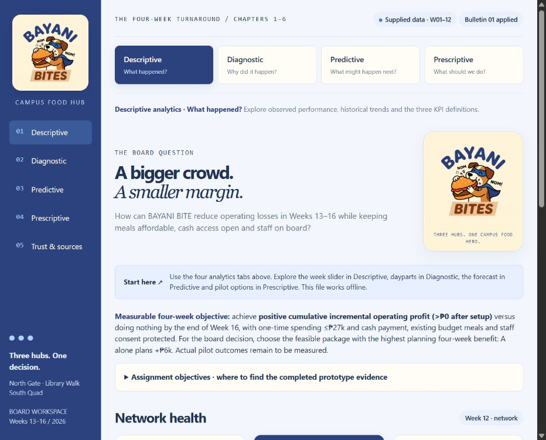

# BAYANI BITE — Campus Rescue Board

An interactive campus food operations dashboard with a blue-and-cream theme and the supplied BAYANI BITES mascot. The app is a complete static site: HTML, CSS, JavaScript, data and the mascot are embedded in `dist/index.html`.

## Open the dashboard

Download the repository or `BAYANI_BITE_Submission.zip`, then open `dist/index.html` in a modern browser with JavaScript enabled. No account, database, API, package installation or internet connection is required.

For a local web preview:

```sh
python -m http.server 8766 --directory dist
```

Open `http://localhost:8766/`.

## Deploy on Vercel

Import this GitHub repository into Vercel. The root `vercel.json` selects these settings:

| Setting | Value |
| --- | --- |
| Root Directory | Repository root (`.`) |
| Framework Preset | Other |
| Build Command | None / empty |
| Install Command | None / empty |
| Output Directory | `dist` |

The deployment serves `dist/index.html` at `/`. Tab navigation uses URL fragments such as `/#diagnostic`, so it does not need server-side routing or rewrites. No environment variables are required.

Configuration reference: [Vercel static configuration](https://vercel.com/docs/project-configuration/vercel-json).

## Explore the four analytics views

- **Descriptive:** historical network KPIs, week/metric explorer, formulas and the assignment objective map.
- **Diagnostic:** revenue/cost pressure, Week 12 branch/daypart comparisons, survey evidence and rival explanations.
- **Predictive:** three-week moving average, Week 12 holdout validation and the future testing plan.
- **Prescriptive:** interactive packages, budget feasibility, Bulletin 01 update, retained initial choice and review measures.

Control selections persist while switching tabs. Use Left/Right or Home/End when a tab is focused. Trust & sources contains data judgment and the actual AI audit.

## Bulletin 01 and planning decision

The actual bulletin is applied on every opening: setup budget **PHP27k**, option C uplift estimate **PHP1k–4k/week**, and C setup cost unchanged at **PHP8k**. The default recommendation is **A alone**: PHP18k setup, PHP6k planning four-week incremental benefit, PHP18k zero-uplift failure loss and negative PHP28.7k ongoing weekly operating profit before setup spending.

The retained initial **A+C** package changes from **+PHP7k** to **−PHP5k** four-week impact after the bulletin; its PHP26k setup still fits the revised budget. These are planning estimates, not observed treatment effects or realized pilot results.

Forecasting keeps time order: Weeks 1–11 history is available; Weeks 9–11 predict the Week 12 holdout at 1,450 orders versus 1,400 actual, giving absolute error 50. Weeks 10–12 forecast 1,430 orders for Week 13. Future actual orders have not been supplied.

## Files

| Path | Purpose |
| --- | --- |
| `dist/index.html` | Complete runnable application and deployment entry point |
| `dist/assets/bayani-bites-mascot.png` | Original supplied mascot; also embedded inside the HTML |
| `source-data/` | Original teaching packet and CSV observations |
| `source-data/bulletin01/` | The three authoritative bulletin files |
| `prepare.py` | Re-embeds supplied data and independently verifies calculations using Python Decimal |
| `check.cjs` | JavaScript syntax, unchanged history and embedded bulletin checks |
| `verification.json` | Calculation checks, including all 32 option subsets |
| `BAYANI_BITE_Decision_Record.json` | Final recommendation, retained initial choice and assumptions |
| `*-screenshot.png` | Captured views of the working prototype |
| `BAYANI_BITE_Submission.zip` | Runnable offline submission with source evidence |
| `README.txt` | Brief opening instructions for the submission |
| `vercel.json` | Static Vercel deployment settings |

## Verify

Run the lightweight source check with Node.js:

```sh
node check.cjs
```

Recalculate from the supplied CSVs using Python 3 and its standard library:

```sh
python prepare.py
node check.cjs
```

The source history remains fixed. Cash payment, existing budget-meal access, staff consent and no involuntary overtime are pilot safeguards; missing access baselines must be collected at launch.

## Preview



Fictional teaching case. All financial amounts are PHP thousands unless stated otherwise.
